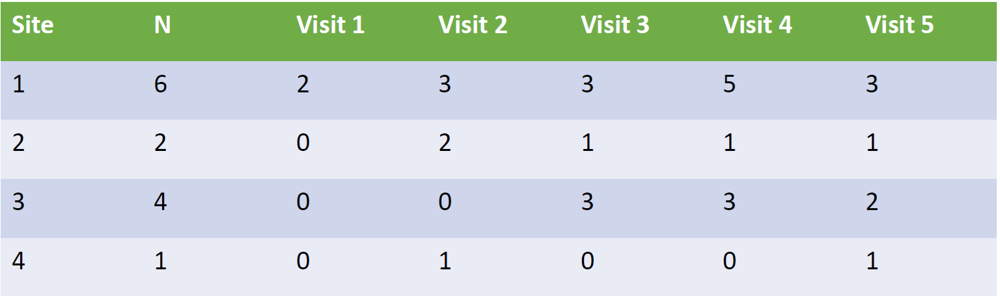

## Objectives

<!-- knitr::purl("./FW670/likelihood.qmd", output="./FW670/likelihood.R") -->

- N-mixture model
- Occurrence Probability and Abundance
- Integrated Data Modeling

## A new model {.scrollable}

- [Royle 2004](https://academic.oup.com/biometrics/article/60/1/108/7289296)
    - [Bayesian Analysis of Spatially Structured Population Dynamics](https://link.springer.com/book/10.1007/978-3-031-64518-1)

- Another way to estimate abundance with imperfect detection
  - mark recapture
  - removal sampling
  - distance sampling
  - double observer

## N-mixture model {.scrollable}

::: {.incremental}
- Fundamentally a 'count model' that corrects for detection probability 
- "Capture–recapture studies can be difficult to implement" (Royle, 2004)
    - Maybe more useful for sparse data (few sites, few occasions, small detection probability, some
zeros)
- **Data Inputs**: Replicated spatial counts 
- **Abundance**: follows a Poisson distribution
- **Detection**: follows a Binomial distribution

::: 

## N-mixture model 

$y_{i,t}$ = number of individuals observed at site $i=1...R$ during $t=1...T$ sampling occasions. 

$$
\begin{align*}
y_{i,t} \sim& \text{Binomial}(N_i, p) \\
N_i \sim& \text{Poisson}(\lambda)
\end{align*}
$$

- $N_i$ = size of population at site $i$
- $\sum_{i=1}^R N_i$ = total population size

. . .

**Priors::**

- $\text{log}(\lambda) \sim \text{Normal}(0,10)$
- $\text{logit}(p) \sim \text{Logistic}(0,1)$

## Data

{fig-align="center" width="300"}

