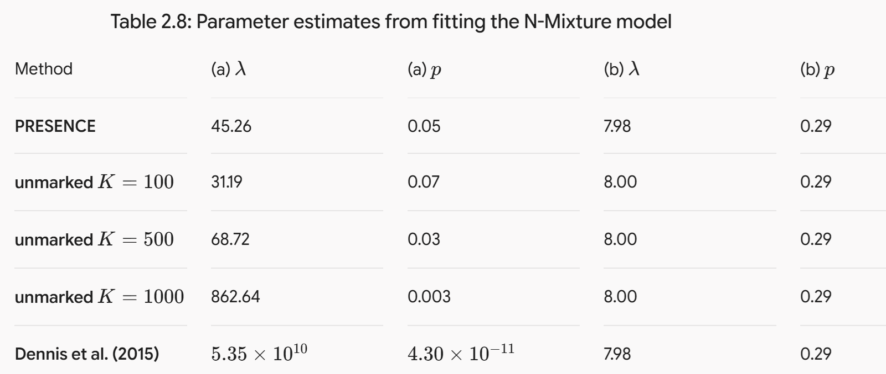
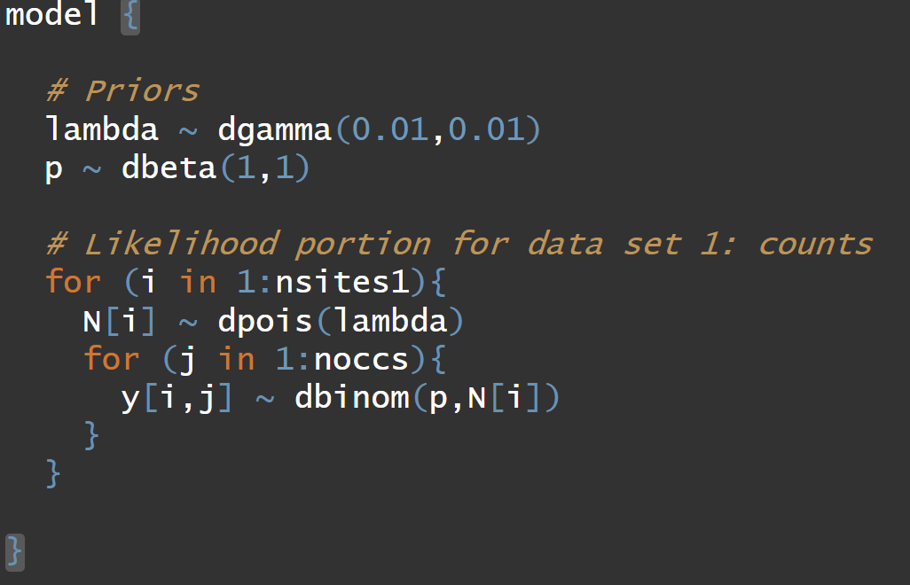
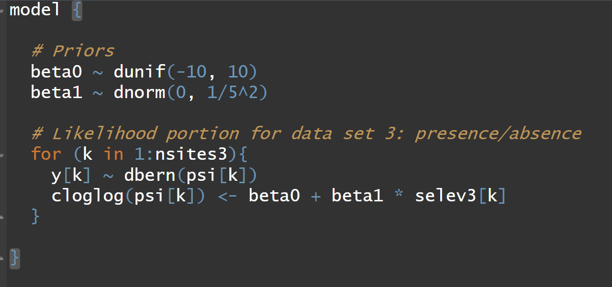
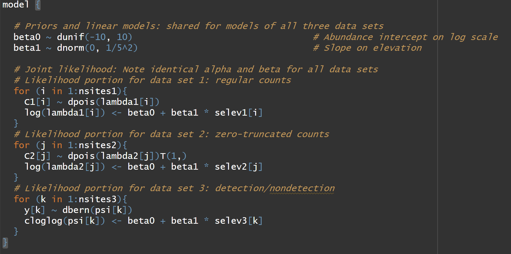

## Objectives

<!-- knitr::purl("./FW670/likelihood.qmd", output="./FW670/likelihood.R") -->

- N-mixture model
- Occurrence Probability and Abundance
- Integrated Data Modeling

## A new model {.scrollable}

- [Royle 2004](https://academic.oup.com/biometrics/article/60/1/108/7289296)
    - [Bayesian Analysis of Spatially Structured Population Dynamics](https://link.springer.com/book/10.1007/978-3-031-64518-1)

- Another way to estimate abundance with imperfect detection
  - mark recapture
  - removal sampling
  - distance sampling
  - double observer


## N-mixture model 

- Fundamentally a 'count model' that corrects for detection probability 

::: {.incremental}
- "Capture–recapture studies can be difficult to implement" (Royle, 2004)
    - Maybe more useful for sparse data (few sites, few occasions, small detection probability, some
zeros)
- **Data Inputs**: Replicated spatial counts 
- **Abundance**: State process is a Poisson distribution
- **Detection**: Observation process is a Binomial distribution

::: 

## N-mixture model {.scrollable}

$y_{i,t}$ = number of individuals observed at site $i=1...R$ during $t=1...T$ sampling occasions. 

. . .

$$
\begin{align*}
y_{i,t} \sim& \text{Binomial}(N_i, p) \\
N_i \sim& \text{Poisson}(\lambda)
\end{align*}
$$

. . .

- $N_i$ = size of population at site $i$
- $\sum_{i=1}^R N_i$ = total population size

. . .

**Priors:**

- $\text{log}(\lambda) \sim \text{Normal}(0,3)$
- OR, $\lambda \sim \text{Gamma}(0.01,0.01)$
- $\text{logit}(p) \sim \text{Logistic}(0,1)$
- OR, $p \sim \text{Beta}(1,1)$


## N Mixture Model


**Assumptions:**

1) Poisson and binomial distributions are true descriptions of state and observation processes; i.e., variation in abundance can be described by the assumed distribution (e.g., Poisson). 


:::{.incremental}

2) Abundance at each site $i$ is random and independent of abundance at all other sites; 
3) Population is closed among surveys

4) Observers do not double count individuals

5) All individuals have the same detection probability or otherwise modeled

:::

## Data

{fig-align="center" width="300"}


## N-mixture extensions

$y_{i,t}$ = number of individuals observed at site $i=1...R$ during $t=1...T$ sampling occasions. 

$$
\begin{align*}
y_{i,t} \sim& \text{Binomial}(N_i, p_{i,t}) \\
N_i \sim& \text{Poisson}(\lambda_i)
\end{align*}
$$

. . .

$$
\begin{align*}
\text{logit}(p_{i,t}) =& \beta_0 + \beta_1 \times x_{i,t} \\
\text{log}(\lambda_{i}) =& \alpha_0 + \alpha_1 \times w_{i} + \epsilon_{i} \\
\epsilon_{i} \sim& \text{Normal}(0,\sigma^2)
\end{align*}
$$

## More extensions

- Other distributions
    - Negative-binomial
    - Zero-inflated Poisson
    - Multinomial
    
- Integrate known date or distance information 

- Multiple states, ages, or sexes

- Spatial movement, e.g., temporary emigration

## Implementation

- Maximum likelihood
    - Unmarked pacakge; pcount function
    
- Bayesian
    - ubms package
    - JAGS, nimble, INLA, stan

## Concerns

**Parameter Identifiability**: "A model is identifiable if there is only one set of parameter values that result in a single model output". [(Cole book)](https://link.springer.com/article/10.1007/s13253-021-00441-7)

. . .

**Data Identifiability**: a condition of the unique dataset that does not allow the model to estimate a unique set of parameters to be output

. . .

{fig-align="center" width="700"}

## Concerns

[Link et al. 2018](https://esajournals.onlinelibrary.wiley.com/doi/full/10.1002/ecy.2362)

[Barker et al. 2017](https://onlinelibrary.wiley.com/doi/full/10.1111/biom.12734)

- 2% double counting can lead to ~20% bias

::: {.incremental}
- small unmodelled heterogenity in $p$ can lead to 20% bias
- small distributional assumption violation leads to CI coverage of 17%
:::

## Concerns

[Link et al. 2018](https://esajournals.onlinelibrary.wiley.com/doi/full/10.1002/ecy.2362)

[Barker et al. 2017](https://onlinelibrary.wiley.com/doi/full/10.1111/biom.12734)


- "fundamentally count data under imperfect detection can only be reliably used as indices." (i.e., relative abundance, not absolute abundance)

. . .

... this is because without auxiliary information about $p$, count data cannot distinguish between an N-mixture model and other possible models (GLM).


## Concerns

[Kery, 2017 ](https://esajournals.onlinelibrary.wiley.com/doi/pdf/10.1002/ecy.2093)

- Testing concern with 137 bird datasets
- Small sample size caused issues (<267 sites)
- Covariates did not affect identifiabiltiy
- No identifiability issues for Poisson and ZIP distributional assumptions
- 25% of datasets had issues with Negative Binomial distribution


## N-mixture model

Go to code....

{fig-align="center" width="300"}


## Occurrence Probability and Expected Abundance {.scrollable}

$\psi$ = probability of occurrence

$\lambda$ = mean count/abundance


. . .


$$
\psi = P(Y=1)
$$

. . .

$$
\psi = P(Y=1) = P(N>0)
$$

. . .

$$
\psi = P(Y=1) = P(N>0) = 1 - e^{-\lambda}
$$

. . .


```{r,echo=TRUE}
lambda = 2
psi = 1 - exp(-lambda)
psi
```

. . .

The Probability of observing > 0 counts, given lambda = 2 

```{r,echo=TRUE}
ppois(0,lambda=2,lower.tail = FALSE)
```

## More to the idea {.scrollable}

**Starting with:**

$$
\psi = 1 - e^{-\lambda}
$$

. . .

**Lets rearrange:**

$$
e^{-\lambda} = 1 - \psi
$$

. . .

$$
\text{log}(e^{-\lambda}) = \text{log}(1 - \psi)
$$

. . .

$$
-\lambda = \text{log}(1 - \psi)
$$

. . .

$$
\lambda = -\text{log}(1 - \psi)
$$


. . .

$$
\text{log}(\lambda) = \text{log}(-\text{log}(1 - \psi))
$$

. . .

The right side is called the 'complimentary log-log link function'.

## The end result {.scrollable}

$$
\text{log}(\lambda) = \text{log}(-\text{log}(1 - \psi))
$$

OR

$$
\text{log}(-\text{log}(1 - \psi)) = \text{log}(\lambda)
$$

. . .

OR

$$
\text{cloglog}(\psi) = \text{log}(\lambda) 
$$

. . .

OR

$$
\text{cloglog}(\psi) = \text{log}(\beta_0 + \beta_1 \times x_1)
$$

## The model all together {.scrollable}


$y_i$ are the presence and absences of the species at site $i$...

$$
y_i \sim \text{Bernoulli}(\psi_i) \\
\text{cloglog}(\psi_i) = \beta_0 + \beta_1 \times x_i
$$

## Presence/Absence Model

Go to code....

{fig-align="center" width="300"}


## Integrated Data Model

- a hierarchical model 

::: {.incremental}

- separate response variables where at least one parameter is shared among at least 2 response variables

- "It just makes sense to use all the information that is available in some estimation task" (Kery and Kellner, 2024)

:::

## Integrated Data Model

- **Names**: integrated model, data fusion, data assimilation

- specific types:
    - integrated population models
    - integrated species distribution models
    - integrated community model
    - integrate dynamic N-mixture model


## Integrated Data Model

"datastream specific observation submodels that inform a common ecological model” [Gilbert et al. 2021](https://www.sciencedirect.com/science/article/pii/S0006320721001993)

## Integrated Species Distribution Model

In chapter 20 of Kery and Kellner, 2024 they introduce three data sets.

1. Counts of swifts ($y_1$)
2. Counts of swifts, but the "lazy" birdwatchers didn't record the zero counts ($y_2$)
3. Observers recorded whether swifts were present (1) or not (0) ($y_3$)

## Integrated Species Distribution Model

We could fit each separately, but...

. . .

Or, could fit a model that leverages all three data sets, each with their own observation model but a single joint 'process/state' model.


## Integrated Data Model {.scrollable}


#### Sub model 1

$$
\begin{align*}
y_{1,i} \sim \text{Poisson}(\lambda)
\end{align*}
$$


#### Sub model 2

$$
\begin{align*}
y_{2,i} \sim \text{ZT Poisson}(\lambda)
\end{align*}
$$


#### Sub model 3

$$
\begin{align*}
y_{3,i} \sim \text{Binomial}(\psi)
\end{align*}
$$


## Integrated Data Model {.scrollable}


#### Sub model 1

$$
\begin{align*}
y_{1,i} \sim& \text{Poisson}(\lambda_{i}) \\
\text{log}(\lambda_{i}) =& \beta_0 + \beta_1 \times x_i
\end{align*}
$$

::: {.fragment}

#### Sub model 2

$$
\begin{align*}
y_{2,i} \sim& \text{ZT Poisson}(\lambda_i)\\
\text{log}(\lambda_{i}) =& \beta_0 + \beta_1 \times x_i
\end{align*}
$$

::: 


::: {.fragment}

#### Sub model 3

$$
\begin{align*}
y_{3,i} \sim& \text{Binomial}(\psi_{i})\\
\text{cloglog}(\psi) =& \beta_0 + \beta_1 \times x_i
\end{align*}
$$

:::


## Integrated Data Model 

Go to code...

{fig-align="center" width="300"}


